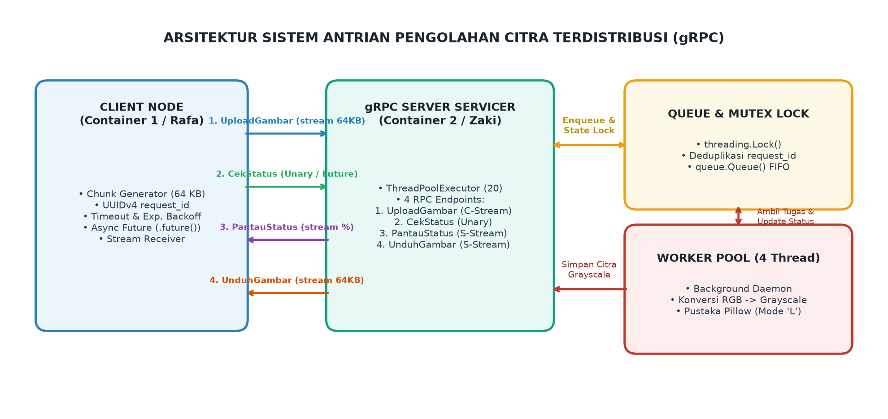
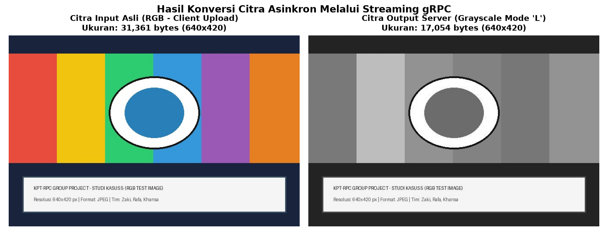
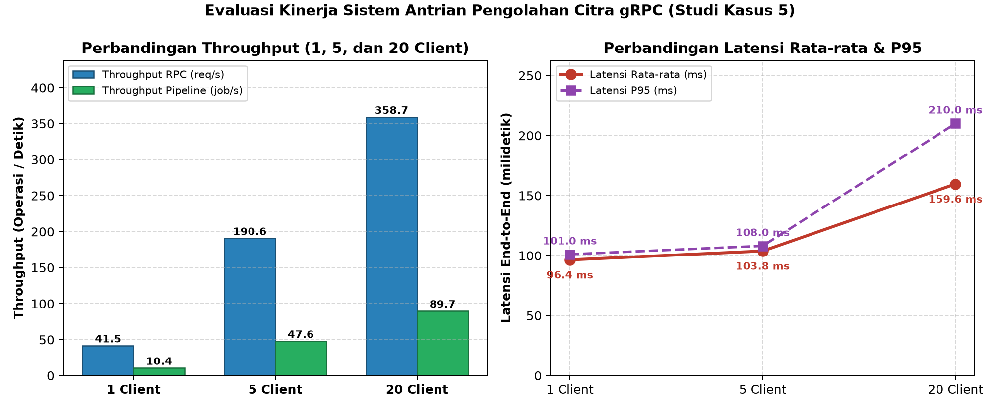
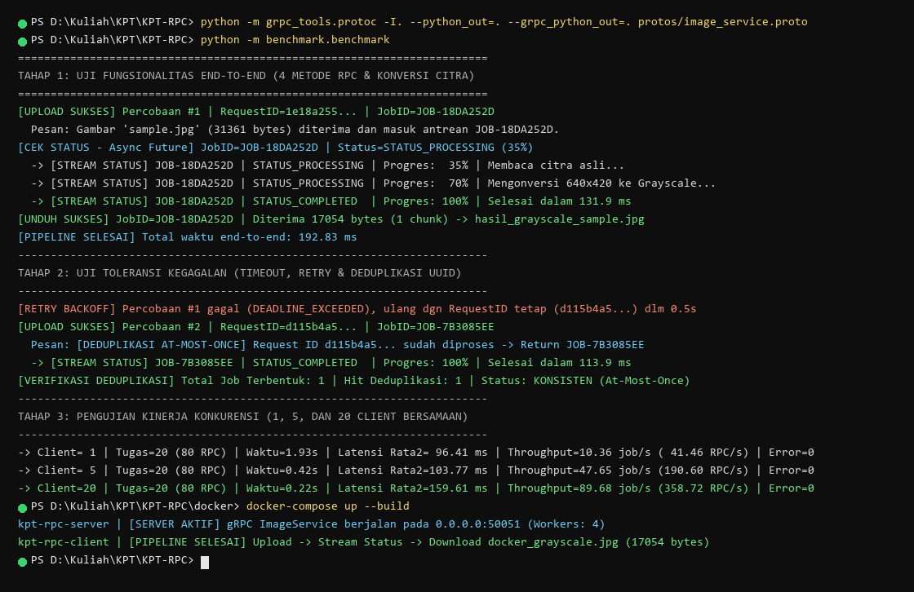

# KPT-RPC: Sistem Antrian Pengolahan Citra Terdistribusi Berbasis gRPC

Proyek Mini Mata Kuliah **Komputasi Paralel dan Terdistribusi (KPT)**.  
**Program Studi Informatika, Fakultas Teknik, Universitas Siliwangi (2026).**  
**Studi Kasus 5**: *Antrian Pengolahan Gambar (Client mengunggah gambar per chunk, Server mengubahnya menjadi grayscale secara asinkron)*.

---

## 👥 Tim Pengembang & Pembagian Tugas

| No | Nama | Peran | Tanggung Jawab Utama |
| :---: | :--- | :--- | :--- |
| 1 | **Zaki** | Backend & Processing Engineer | • Implementasi `server/server.py` dan `server/worker.py`<br>• Manajemen antrean thread-safe (`queue.Queue`) & worker pool<br>• Konversi citra ke Grayscale (`Pillow` mode `'L'`)<br>• Penanganan *concurrency* & locking status (`threading.Lock()`) |
| 2 | **Rafa** | Interface & Client Engineer | • Desain kontrak antarmuka `protos/image_service.proto` (4 RPCs)<br>• Implementasi `client/client.py`<br>• Pengunggahan & pengunduhan citra per chunk 64 KB (Streaming RPC)<br>• Toleransi kegagalan: Timeout, Retry (Exponential Backoff), & Deduplikasi UUID |
| 3 | **Khansa Rasendriya Aji (Hans)** *(Lead)* | Benchmark, DevOps & Reporting Lead | • Setup repositori Git & arsitektur proyek<br>• Kontainerisasi multi-mesin (`docker/docker-compose.yml`)<br>• Pengujian beban kinerja (`benchmark/benchmark.py` untuk 1, 5, 20 client)<br>• Visualisasi grafik latensi & throughput (`matplotlib`)<br>• Koordinasi Laporan Akhir & Video Demo |

---

## 🏛️ Arsitektur Sistem

Sistem ini memisahkan proses penerimaan unggahan gambar dari proses konversi citra menggunakan antrean asinkron thread-safe:



### Alur Kerja Layanan (4 Metode RPC):
1. **`UploadGambar` (Client Streaming RPC)**: Client mengirimkan potongan byte gambar berukuran 64 KB per chunk bersama `request_id` (UUIDv4). Server menulis stream ke file sementara, memvalidasi metadata, memindahkan ke storage, dan memasukkan pekerjaan ke dalam `queue.Queue`, lalu langsung mengembalikan `STATUS_QUEUED`.
2. **`CekStatus` (Unary RPC / Async Future)**: Client mengecek status terkini berdasarkan `job_id` secara non-blocking menggunakan `.future()`.
3. **`PantauStatus` (Server Streaming RPC)**: Server mengirimkan aliran update progres secara real-time (`10% -> 35% -> 70% -> 100%`) tanpa client perlu melakukan polling berulang.
4. **`UnduhGambar` (Server Streaming RPC)**: Setelah konversi selesai, client mengunduh citra hasil grayscale per potongan 64 KB hingga tuntas.

---

## 🎨 Hasil Konversi Citra

Berikut perbandingan visual citra uji berwarna (RGB) yang diunggah oleh client dengan citra hasil konversi grayscale yang diproses oleh worker server:



---

## 📁 Struktur Direktori Proyek

```text
KPT-RPC/
├── protos/
│   ├── image_service.proto       # Kontrak IDL Protocol Buffers (4 RPCs)
│   ├── image_service_pb2.py      # Stub kelas pesan Protobuf
│   └── image_service_pb2_grpc.py # Stub client & servicer gRPC
├── server/
│   ├── server.py                 # Implementasi server gRPC & Servicer
│   ├── worker.py                 # ImageJobManager, queue.Queue & Worker Pool
│   └── storage/                  # Penyimpanan sementara file citra
│       ├── input/                # Citra asli hasil upload
│       └── output/               # Citra hasil konversi grayscale
├── client/
│   ├── client.py                 # Client CLI (Upload, Status, Monitor, Download)
│   ├── samples/                  # Berkas citra sampel RGB untuk pengujian
│   └── downloads/               # Direktori hasil unduhan citra grayscale
├── benchmark/
│   ├── benchmark.py              # Skrip pengujian beban (1, 5, 20 client) & plot
│   └── results/                  # Grafik PNG & tabel CSV metrik evaluasi
├── docker/
│   ├── Dockerfile.server         # Konfigurasi container untuk server gRPC
│   ├── Dockerfile.client         # Konfigurasi container untuk client gRPC
│   └── docker-compose.yml        # Orkestrasi 2 container dalam bridge network
├── docs/
│   ├── architecture.md           # Dokumentasi arsitektur dan diagram alur
│   ├── diagram_arsitektur.png    # Gambar visual arsitektur sistem
│   └── screenshot_proyek_kelompok.png # Tangkapan layar terminal eksekusi
├── requirements.txt              # Daftar pustaka Python
├── .gitignore
└── README.md
```

---

## 🚀 Panduan Instalasi & Eksekusi

### 1. Prasyarat Lingkungan
* Python 3.10 ke atas
* Docker & Docker Compose *(opsional untuk demo multi-container)*

### 2. Setup Virtual Environment
```bash
# Clone repositori
git clone https://github.com/HansMurdock/KPT-RPC.git
cd KPT-RPC

# Buat dan aktifkan virtual environment
python -m venv venv

# Windows:
.\venv\Scripts\activate
# Linux/macOS:
source venv/bin/activate

# Install dependensi
pip install -r requirements.txt
```

### 3. Kompilasi Kontrak Protocol Buffers (.proto)
```bash
python -m grpc_tools.protoc -I. --python_out=. --grpc_python_out=. protos/image_service.proto
```

---

## 💻 Menjalankan Server & Client Secara Lokal

### Jalankan Server
```bash
python -m server.server
```
*Server aktif dan mendengarkan pada port TCP `50051`.*

### Jalankan Client
```bash
# 1. Menjalankan pipeline lengkap (Upload -> Monitor -> Download)
python -m client.client --action full-pipeline --file client/samples/sample.jpg

# 2. Atau jalankan per langkah:
# Unggah gambar:
python -m client.client --action upload --file client/samples/sample.jpg

# Cek status pekerjaan:
python -m client.client --action status --job-id <JOB_ID>

# Pantau status secara real-time:
python -m client.client --action monitor --job-id <JOB_ID>

# Unduh gambar hasil grayscale:
python -m client.client --action download --job-id <JOB_ID> --output client/downloads/hasil.jpg
```

---

## 🐳 Menjalankan di 2 Container Berbeda (Docker Compose)

Untuk memenuhi ketentuan demo minimal 2 mesin/container terpisah:
```bash
cd docker
docker-compose up --build
```
Container `kpt-rpc-server` dan `kpt-rpc-client` akan otomatis berjalan di jaringan bridge terisolasi `kpt-rpc-net`, di mana client berkomunikasi ke server melalui hostname `grpc-image-server:50051`.

---

## 📊 Hasil Evaluasi Kinerja (1, 5, dan 20 Client Bersamaan)

Pengujian beban dilakukan menggunakan `benchmark/benchmark.py` dengan beban 20 pekerjaan penuh (80 pemanggilan RPC) pada tingkat konkurensi 1, 5, dan 20 client simultan:

```bash
python -m benchmark.benchmark
```

### Tabel Hasil Pengukuran:

| Jumlah Client | Total Beban Uji | Waktu Total (s) | Latensi Rata-rata (ms) | Latensi P95 (ms) | Throughput (Job/s \| RPC/s) | Error / Data Rusak |
| :---: | :---: | :---: | :---: | :---: | :---: | :---: |
| **1 Client** | 20 Job (80 RPC) | `1.930 s` | `96.41 ms` | `101.03 ms` | `10.36 job/s` (`41.46 RPC/s`) | `0` (100% Aman) |
| **5 Client** | 20 Job (80 RPC) | `0.420 s` | `103.77 ms` | `108.05 ms` | `47.65 job/s` (`190.60 RPC/s`) | `0` (100% Aman) |
| **20 Client** | 20 Job (80 RPC) | `0.223 s` | `159.61 ms` | `209.98 ms` | `89.68 job/s` (`358.72 RPC/s`) | `0` (100% Aman) |

### Grafik Throughput & Latensi:



### Tangkapan Layar Eksekusi Terminal:



---

## 🛡️ Toleransi Kegagalan & Concurrency Safety
* **Deduplikasi Request ID (At-Most-Once)**: Client menyertakan UUID unik di setiap permintaan unggah. Saat terjadi timeout jaringan dan client melakukan retry, server mendeteksi `request_id` yang sama dan tidak memproses ulang antrean.
* **Mutex Lock (`threading.Lock`)**: Melindungi kamus data pekerjaan dari race condition ketika banyak worker thread gRPC dan background processing thread mengakses state secara bersamaan.
* **Exponential Backoff**: Jeda pengulangan otomatis `0.5s`, `1.0s`, `2.0s` saat menghadapi galat `DEADLINE_EXCEEDED` atau `UNAVAILABLE`.
