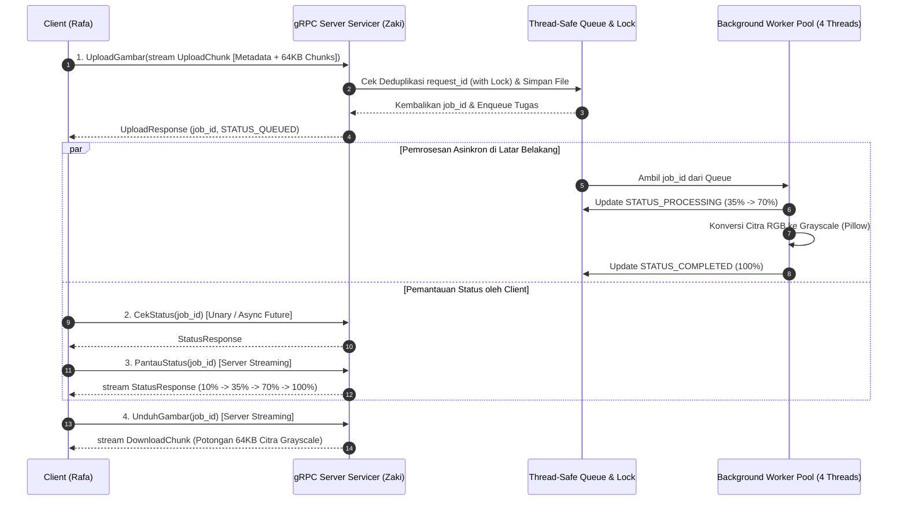

# Arsitektur Sistem Antrian Pengolahan Citra Terdistribusi Berbasis gRPC

## 1. Gambaran Umum Studi Kasus 5
Sistem ini mengimplementasikan layanan pengolahan citra terdistribusi berbasis **gRPC** dan **Protocol Buffers (proto3)**. Client mengirimkan berkas gambar berwarna (RGB) secara bertahap per potongan byte (*chunk* 64 KB) melalui *Client Streaming RPC*. Server menyimpan berkas ke penyimpanan lokal, mencatat pekerjaan di dalam struktur data yang dilindungi *mutex lock* (`threading.Lock()`), lalu memasukkan `job_id` ke dalam antrean tugas asinkron (`queue.Queue`). Sekumpulan *background worker thread* (`ImageWorkerPool`) mengambil tugas dari antrean, mengonversi citra menjadi *grayscale* (`Pillow`), dan memperbarui status progres secara *thread-safe*.

## 2. Diagram Alur Komponen & Pemanggilan RPC

## 3. Spesifikasi Keempat Metode RPC (`protos/image_service.proto`)

| No | Nama RPC | Pola Komunikasi | Input Message | Output Message | Fungsi & Alasan Pemilihan Pola |
| :-: | :--- | :--- | :--- | :--- | :--- |
| 1 | `UploadGambar` | **Client Streaming** | `stream UploadChunk` | `UploadResponse` | Mengunggah citra berukuran besar per *chunk* (64 KB) tanpa membebani RAM sekaligus; dilengkapi `request_id` untuk deduplikasi *At-Most-Once*. |
| 2 | `CekStatus` | **Unary RPC** *(Async Future)* | `StatusRequest` | `StatusResponse` | Mengecek status pekerjaan secara cepat (*idempoten*); mendukung pemanggilan non-blocking via `.future()`. |
| 3 | `PantauStatus` | **Server Streaming** | `StatusRequest` | `stream StatusResponse` | Mendorong pembaruan persentase progres (`10% -> 35% -> 70% -> 100%`) secara *real-time* dari server ke client tanpa *polling* berulang. |
| 4 | `UnduhGambar` | **Server Streaming** | `DownloadRequest` | `stream DownloadChunk` | Mengunduh citra hasil konversi *grayscale* secara bertahap per *chunk* (64 KB) hingga byte terakhir diterima utuh oleh client. |
